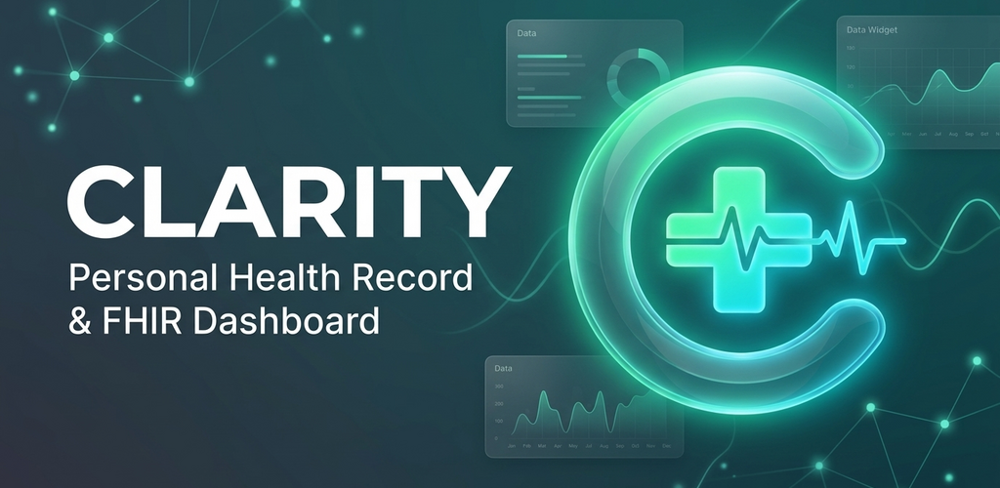

# Clarity (Personal Health Record)

<p align="center">
  
</p>

<p align="center">
  <strong>Open-Source Personal Health Record (PHR) Mobile App built with Flutter, HL7® FHIR® R4, and SMART on FHIR.</strong>
</p>

<p align="center">
  
  
  
  
  
  
</p>

<p align="center">
  
</p>

---

## Table of Contents

- [Overview](#overview)
- [Key Features](#key-features)
- [Supported FHIR Resources & Standards](#supported-fhir-resources--standards)
- [Architecture & Tech Stack](#architecture--tech-stack)
- [Project Structure](#project-structure)
- [Getting Started](#getting-started)
  - [Prerequisites](#prerequisites)
  - [Installation](#installation)
  - [Running the App](#running-the-app)
  - [Running Tests & Static Analysis](#running-tests--static-analysis)
  - [Building for Release](#building-for-release)
- [OAuth & SMART on FHIR Configuration](#oauth--smart-on-fhir-configuration)
- [Improvement Roadmap](#improvement-roadmap)
- [Contributing & Developer Guide](#contributing--developer-guide)
- [Medical Disclaimer & License](#medical-disclaimer--license)

---

## Overview

**Clarity** is a cross-platform Personal Health Record (PHR) mobile application designed to bridge the gap between patients, healthcare providers, and clinical health records. 

By leveraging the **HL7® FHIR® Release 4** standard and the **SMART on FHIR** OAuth 2.0 authorization framework, Clarity empowers users to connect directly and securely to compliant electronic health record (EHR) systems and national health data exchanges (such as the Taiwan Ministry of Health and Welfare THAS platform or SMART Health IT sandboxes) without proprietary middlemen.

### Core Goals

- **Patient Empowerment:** Give patients immediate, structured visibility into their clinical history, medications, allergies, and diagnostic results.
- **Provider Utility:** Provide clinicians and practitioners with a quick, standardized glance at patient demographics, vital signs, and encounter timelines.
- **Open Standards:** Promote strict adoption of HL7 FHIR R4, LOINC, and SMART App Launch specifications.

---

## Key Features

### 1. SMART on FHIR Authentication
- **OAuth 2.0 SMART Launch:** Full authorization code flow handling via secure custom tabs and web authentication (`flutter_web_auth_2`).
- **Flexible Launch Contexts:** Pre-configured launch profiles for both **Practitioner** (`{"h":"1"}`) and **Patient** (`{"k":"1","j":"1"}`) roles.
- **Server Picker & Custom Endpoints:** Out-of-the-box support for Taiwan MoHW THAS (`https://thas.mohw.gov.tw/v/r4`), plus the ability to add, persist (`SharedPreferences`), and connect to custom FHIR R4 endpoints.

### 2. Clinical Profile & Dashboard
- **Demographics & Profile:** Displays full patient name, birth date, gender, and dynamically calculated age (`years • days`).
- **Practitioner Identity:** Decodes SMART `id_token` JWT payload to extract the `fhirUser` reference and display attending practitioner information.
- **Vital Signs Panel:** Real-time retrieval of vital sign measurements using standardized LOINC codes:
  - Height (`8302-2`) & Weight (`29463-7`)
  - Blood Type (ABO Group `883-9` & Rh Type `10331-6`)
  - Blood Pressure Panel (`55284-4`: Systolic `8480-6` / Diastolic `8462-4`)
  - Heart Rate (`8867-4`) & Respiratory Rate (`9279-1`)
  - Oxygen Saturation (`2708-6`)
  - Body Mass Index (BMI `39156-5`)
- **Encounter Timeline:** Chronological timeline view powered by `timelines_plus` illustrating clinical encounters, visit types (e.g., Standard Consultation), dates, and status badges.

### 3. Paginated Sub-Resource Explorers
Sub-pages feature infinite scrolling pagination (triggering next page loads at 90% scroll depth) following the FHIR Bundle `link[relation="next"]` standard:

| Resource Explorer | FHIR Resource | Description & Highlights |
| :--- | :--- | :--- |
| **Laboratory Results** | `Observation` (category: `laboratory`) | Test names, values, units, reference ranges, and interpretation flags. |
| **Vital Signs History**| `Observation` (category: `vital-signs`) | Historical time-series of recorded vitals. |
| **Medications** | `MedicationRequest` | Active and past prescriptions, dosage instructions, and prescribing dates. |
| **Conditions** | `Condition` | Diagnoses and problem list with clinical & verification statuses. |
| **Allergies** | `AllergyIntolerance` | Food and drug allergies with color-coded criticality badges (High, Low, Unable-to-assess) and manifestations. |
| **Vaccinations** | `Immunization` | Vaccine administration history, occurrence dates, lot numbers, and target diseases. |
| **Diagnostic Reports**| `DiagnosticReport` | Diagnostic summaries, category tags, issue dates, and study conclusions. |

---

## Supported FHIR Resources & Standards

Clarity adheres to **HL7® FHIR® R4 (v4.0.1)** and integrates the following health informatics standards:

- **HL7 FHIR R4 Resources:**
  - `Patient`
  - `Practitioner`
  - `Observation`
  - `Encounter`
  - `Condition`
  - `MedicationRequest`
  - `AllergyIntolerance`
  - `Immunization`
  - `DiagnosticReport`
  - `Bundle`
- **Coding Systems & Terminologies:**
  - **LOINC** (Logical Observation Identifiers Names and Codes) for vitals and laboratory observations.
  - **SNOMED CT** for clinical findings, problem lists, and allergen manifestations.
  - **RxNorm** for medication concepts.
- **Security & Authorization:**
  - **SMART on FHIR** App Launch Framework.
  - OAuth 2.0 with custom URL scheme redirect handling (`clarity.kiddos.app://callback`).

---

## Architecture & Tech Stack

```
                        +------------------------------------+
                        |       Authentication Layer         |
                        |     (SMART on FHIR OAuth 2.0)      |
                        |      lib/auth.dart & auth_page     |
                        +-----------------+------------------+
                                          |
                            Token Payload & Base URL
                                          v
                        +------------------------------------+
                        |        Patient Profile Hub         |
                        |   lib/patient_profile_page.dart    |
                        |  - Demographics & Age Calculator   |
                        |  - Attending Practitioner (JWT)    |
                        |  - Real-Time LOINC Vitals Grid     |
                        |  - Chronological Encounter Flow    |
                        +-----------------+------------------+
                                          |
     +---------------+------------+-------+-------+-------------+---------------+
     |               |            |               |             |               |
     v               v            v               v             v               v
   Labs            Vitals    Medications     Conditions      Allergies      Reports/Vaccines
 (Observation) (Observation) (Medication-   (Condition)      (Allergy-      (DiagnosticReport /
                             Request)                       Intolerance)    Immunization)
```

- **Framework:** [Flutter](https://flutter.dev/) (SDK `^3.5.4`)
- **Language:** [Dart](https://dart.dev/)
- **FHIR Toolkit:** [`fhir: ^0.12.1`](https://pub.dev/packages/fhir) for typed R4 resource handling
- **OAuth / Web Auth:** [`flutter_web_auth_2: ^5.0.0`](https://pub.dev/packages/flutter_web_auth_2)
- **HTTP Client:** [`http: ^1.6.0`](https://pub.dev/packages/http)
- **Timeline Visualization:** [`timelines_plus: ^1.0.8`](https://pub.dev/packages/timelines_plus)
- **Data Visualization & Charts:** [`fl_chart: ^1.1.1`](https://pub.dev/packages/fl_chart)
- **Persistence:** [`shared_preferences: ^2.5.3`](https://pub.dev/packages/shared_preferences)
- **Logging:** [`logger: ^2.6.2`](https://pub.dev/packages/logger)
- **Formatting:** [`intl: ^0.20.2`](https://pub.dev/packages/intl)
- **Design System:** Material Design 3 (`useMaterial3: true`) with Teal theme seed color

---

## Project Structure

```
clarity/
├── lib/
│   ├── main.dart                          # App entrypoint
│   ├── main_app.dart                      # MaterialApp definition and Material 3 theme
│   ├── home_page.dart                     # Root navigation wrapper
│   ├── constants.dart                     # OAuth client ID, redirect URI, scopes, and flags
│   ├── log.dart                           # Centralized logger instance
│   ├── auth.dart                          # OAuth2 auth URL builder and token exchange logic
│   ├── auth_page.dart                     # Server selector, launch context, and login UI
│   ├── patient_profile_page.dart          # Primary clinical dashboard (vitals, encounters, profile)
│   ├── patient_lab_page.dart              # Laboratory & Vital signs paginated list
│   ├── patient_medication_page.dart       # MedicationRequest paginated list
│   ├── patient_condition_page.dart        # Medical conditions & problem list
│   ├── patient_allergy_page.dart          # Allergies & intolerances with criticality tags
│   ├── patient_vaccination_page.dart      # Immunization records
│   └── patient_diagnostic_report_page.dart# Diagnostic & laboratory reports
├── assets/
│   └── images/icons/                      # Custom medical icons (vital-signs, blood-pressure, lungs, etc.)
├── playstore-assets/                      # Store assets, 512x512 logo, and 1024x500 feature graphics
├── icons/                                 # Branding icon assets (glass, emblem, luminous, logo)
├── android/
│   ├── app/src/main/AndroidManifest.xml   # Deep link callback activity (clarity.kiddos.app)
│   └── app/build.gradle                   # Android app configuration (applicationId: app.kiddos.fhir.clarity)
├── test/
│   └── widget_test.dart                   # Smoke & widget tests
├── IMPROVEMENTS.md                        # Strategic architecture, security, and feature roadmap
├── AGENTS.md                              # AI agent & developer guidelines and architectural manual
├── analysis_options.yaml                  # Lint rules (flutter_lints)
└── pubspec.yaml                           # Flutter dependencies and asset definitions
```

---

## Getting Started

### Prerequisites

- [Flutter SDK](https://docs.flutter.dev/get-started/install) (version 3.24+ recommended, Dart SDK `^3.5.4`)
- Android Studio / Xcode (for mobile compilation and emulators)
- A compliant FHIR R4 server endpoint (e.g. Taiwan MoHW THAS sandbox or SMART Health IT)

### Installation

1. **Clone the repository:**
   ```bash
   git clone https://github.com/kiddos/clarity.git
   cd clarity
   ```

2. **Install Flutter packages:**
   ```bash
   flutter pub get
   ```

### Running the App

Run on a connected emulator or device:
```bash
flutter run
```

To run with developer flags enabled:
```bash
flutter run --dart-define=IS_DEV=true
```

### Running Tests & Static Analysis

Ensure code quality and test integrity:
```bash
# Analyze code for static warnings and lint issues
flutter analyze

# Run unit and widget tests
flutter test
```

### Building for Release

**Android (APK & App Bundle):**
```bash
flutter build apk --release
flutter build appbundle --release
```

---

## OAuth & SMART on FHIR Configuration

Clarity connects to SMART on FHIR servers using the following parameters defined in `lib/constants.dart`:

- **Client ID:** `app.kiddos.fhir.clarity`
- **Redirect Scheme:** `clarity.kiddos.app`
- **Redirect URI:** `clarity.kiddos.app://callback`
- **Scopes Requested:**
  ```
  openid fhirUser offline_access user/*.* patient/*.* launch/encounter launch/patient profile
  ```

### Deep Link Setup

On Android, OAuth redirection is handled by `com.linusu.flutter_web_auth_2.CallbackActivity` registered in `android/app/src/main/AndroidManifest.xml`:

```xml
<activity
    android:name="com.linusu.flutter_web_auth_2.CallbackActivity"
    android:exported="true">
    <intent-filter android:label="flutter_web_auth_2">
        <action android:name="android.intent.action.VIEW" />
        <category android:name="android.intent.category.DEFAULT" />
        <category android:name="android.intent.category.BROWSABLE" />
        <data android:scheme="clarity.kiddos.app" />
    </intent-filter>
</activity>
```

---

## Improvement Roadmap

For an in-depth exploration of planned architectural and security upgrades, consult [IMPROVEMENTS.md](IMPROVEMENTS.md). Key milestones include:

- **Dynamic SMART Discovery:** Support `/.well-known/smart-configuration` and `CapabilityStatement` discovery across diverse health systems.
- **PKCE (RFC 7636):** Implementation of Proof Key for Code Exchange for mobile client security.
- **Token Refresh Interceptor:** Silent renewal using `offline_access` refresh tokens.
- **Query Optimization:** Batching multi-code Observation requests to replace sequential calls on launch.
- **Reusable Paged List View:** Abstracting repetitive pagination logic across clinical sub-pages.
- **Interactive Trend Charts:** Utilizing `fl_chart` to render historical trends on vital signs and lab results.
- **Internationalization (i18n):** Traditional Chinese (`zh-TW`) and English localization.

---

## Contributing & Developer Guide

We welcome contributions from open-source developers, health informaticians, and medical professionals.

- If you are developing features or interacting via AI coding agents, please read [AGENTS.md](AGENTS.md) for coding conventions, error handling standards, and architecture patterns.
- Always verify changes with `flutter analyze` and `flutter test` before submitting pull requests.

---

## Medical Disclaimer & License

> **DISCLAIMER:** Clarity is an open-source software application developed for informational, educational, and personal health record management purposes. It is not intended to provide medical diagnoses, treatment decisions, or emergency healthcare services. Always seek the advice of a qualified healthcare provider regarding medical conditions.

Distributed under the MIT License. See `LICENSE` for details (if included) or open-source terms.
